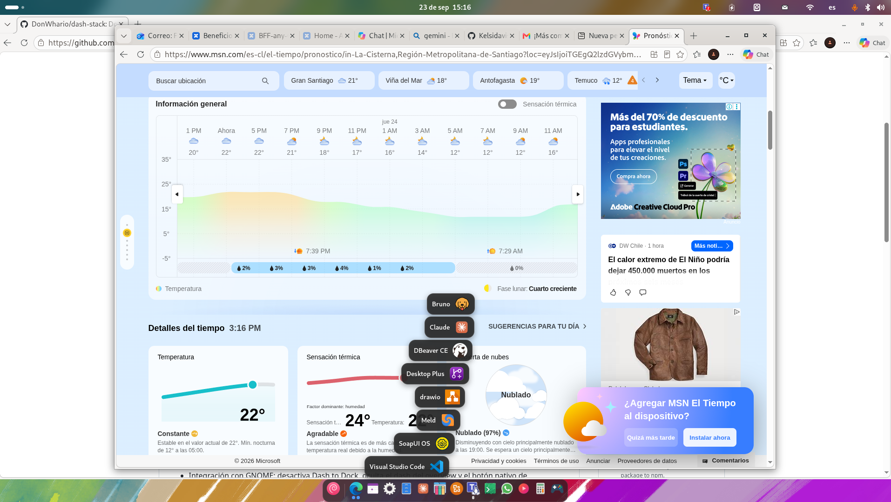

# Dock Stack

Bottom dock for **GNOME Shell 48–51** (Wayland) with macOS-style application
groupings (*stacks*), a custom application grid (*Launchpad*) with live widgets,
a taskbar with running apps, and tray icons (*systray*) in the top panel.

> Personal extension of *Aplicaciones y Utilitarios — ABAZA*.

## Features

### Dock

- **Configurable bottom dock** (icon size, opacity, position, reserved space).
- **macOS-style stacks**: groups of apps or folders that expand as a **grid** or
  a **fan** (curved strip), with ascending/descending order.
- **Navigable folder stacks**: scroll through large folders, drill into
  sub-folders (with a pinned breadcrumb), and a **file-manager-style context
  menu** (open, open with, copy, rename, move to trash…).
- **Workflows**: a dock button that **launches several apps at once** when
  clicked (new window if already running, otherwise starts them).
- **Unified order**: favorites and stacks are mixed and **reordered by dragging**,
  with a fluid animation (icons move aside to open the gap).
- **Running apps** in the dock, grouped per application, with indicator dots and
  window thumbnails on hover.
- **Animated icons**: GIF/APNG/WebP for stacks and the apps button (toggle in
  Preferences).
- Optional **hover shake** (icons tremble under the pointer).
- **Intellihide** and auto-hide; **immersive fullscreen** (hides dock + top bar
  and frees the space for games/video).
- Configurable **login/logout sounds**.

### Application grid (Launchpad)

- Single unified panel: a **category rail** (icon + label) with the current
  user's avatar, **search** (Ctrl+K), alphabetical sorting and a **light/dark
  theme** switcher. Replaces the GNOME *overview*.
- **Calculator in the search**: type a math expression (`2+2`, `sqrt(144)`,
  `(10-2)/4`, `pi*3`…) and the result appears on top; click it to copy.
- **File search**: searching also finds documents and folders in your common
  directories; click a result to open it with the default app.
- **Favorites dashboard**: a Favorites apps card alongside **widget cards**.
- **Drag to reorder** the widget columns to any position in the grid.
- **Genie effect** when opening/closing (grows/shrinks from the menu button).
- Rail category icons adapt to the theme (tinted white in dark mode).

### Grid widgets

- **Weather**: current conditions + 5-day forecast from **Open-Meteo**, with an
  optional **MeteoChile (DMC)** source and a small data-source note.
- **News**: headlines by country (Google News) with resolved article thumbnails.
- **Music player** (MPRIS): now-playing art, title/artist, progress bar and
  transport controls; stacks under the weather card.
- **System resources** (grid only): CPU & RAM rings, a CPU-history sparkline,
  disk usage, network up/down and temperature; stacks under the news card.
- **Text / note**: your own title + free text, shown as a card.
- **Clock** (optionally using the dock's colour/opacity), **Photos** and a
  **script** widget.

### Spaces (profiles)

- Save the current configuration — stacks, widgets, layout and appearance — as a
  named **Space**, and switch between them anytime (apply, update or delete each
  one). Excludes language, sounds and API keys.

### Top bar

- Own **systray** (StatusNotifierItem/AppIndicator).
- **Island mode**: shows only the right-hand indicators block with rounded
  corners; **configurable position** (left / center / right), opacity shared
  with the dock, and indicator menus centred on the island.

### Integration & i18n

- **Multilingual UI**: Spanish, English, Portuguese, French and German (follows
  the system language, or a manual selector; falls back to English).
- **Burn My Windows integration**: the dock sets each window's minimize target to
  its dock icon, so the *magic lamp* aims at the right icon.
- Disables Dash to Dock, hides the overview dash and the native applications
  button while active.
- **Preferences** panel (General / Stacks / Widgets / Spaces / About).

## Screenshot



## Requirements

- GNOME Shell **48–51**
- **Wayland** session (recommended)

## Installation

### From the package (.zip)

```bash
gnome-extensions install --force dock-stack@felipe.local.shell-extension.zip
```

Log out and back in, then enable it:

```bash
gnome-extensions enable dock-stack@felipe.local
```

### From source (cloning the repository)

```bash
git clone https://github.com/DonWhario/dash-stack.git \
  ~/.local/share/gnome-shell/extensions/dock-stack@felipe.local
cd ~/.local/share/gnome-shell/extensions/dock-stack@felipe.local
make schemas          # compile the GSettings schemas
gnome-extensions enable dock-stack@felipe.local
```

Log out and back in so GNOME Shell loads it.

## Development

```bash
make schemas   # compile schemas after editing the .gschema.xml
make pack      # build the .zip
make install   # package and install
```

Test without logging out (nested session):

```bash
dbus-run-session -- gnome-shell --nested --wayland
```

Live diagnostics:

```bash
journalctl -f -o cat /usr/bin/gnome-shell
```

## Structure

| File | Description |
|---|---|
| `extension.js`   | Main logic: dock, stacks, grid, widgets layout, drag & drop, intellihide, integration. |
| `widgets.js`     | Grid/dock widgets (weather, news, music, system resources, clock, photos…). |
| `systray.js`     | StatusNotifierItem/AppIndicator host for tray icons. |
| `prefs.js`       | Preferences panel (Adw). |
| `translations.js`| Built-in translations (es, en, pt, fr, de). |
| `stylesheet.css` | Styles for the dock, stacks, grid, widgets and thumbnails. |
| `schemas/`       | GSettings schema. |

## License

[MIT](LICENSE) © 2026 Felipe Abarca
